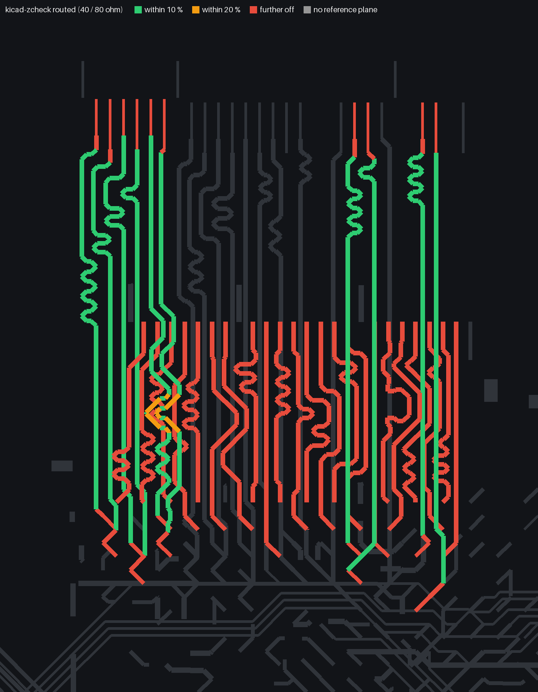
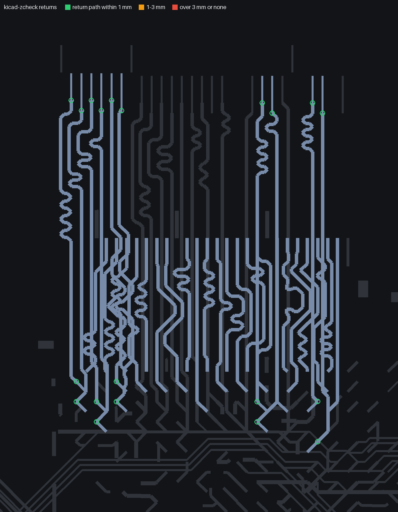
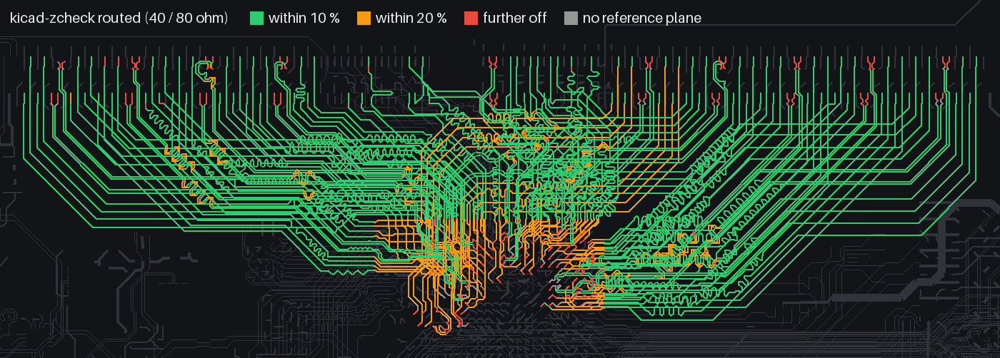
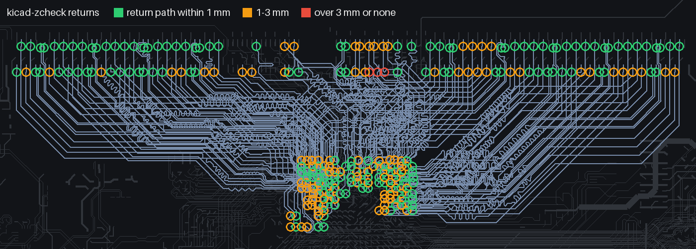

# kicad-zcheck

Impedance and return-path checks on a KiCad board's own stack-up and routed copper. It answers three questions that
the net-class widths alone do not:

1. What width hits the target on each layer of *this* stack-up, and what would a different stack-up need?
2. How much of the copper I actually routed is within tolerance?
3. Where a signal changes layers, how far does its return current have to go to follow it?

## Example: an open-source board

[Antmicro's LPDDR4 test board](https://github.com/antmicro/lpddr4-test-board) (Apache-2.0; commit 5c8b5d3): an 8-layer Kintex-7 FPGA board with an LPDDR4 SO-DIMM socket. LPDDR4 is usually routed to 40 ohm single-ended and 80 ohm differential, so those are the targets here.

```bash
git clone https://github.com/antmicro/lpddr4-test-board && cd lpddr4-test-board
python3 -m kicad_zcheck widths lpddr4-test-board.kicad_pcb --se 40 --diff 80 --at 0.1
```

```
board stack-up: planes In1.GND, In3.GND, In4.VCC, In6.VCC; total 1.580 mm
  F.Cu     microstrip h 0.186 mm: 40 ohm SE w=0.483 | 80 ohm diff w=0.272 at gap 0.1 | Z0 at 0.1 = 87
  In2.Cu   stripline  h 0.186 / 0.186 mm: 40 ohm SE w=0.203 | 80 ohm diff w=0.123 at gap 0.1 | Z0 at 0.1 = 54
  In5.Cu   stripline  h 0.186 / 0.186 mm: 40 ohm SE w=0.203 | 80 ohm diff w=0.123 at gap 0.1 | Z0 at 0.1 = 54
  B.Cu     microstrip h 0.186 mm: 40 ohm SE w=0.483 | 80 ohm diff w=0.272 at gap 0.1 | Z0 at 0.1 = 87
```

The planes come from the layer types set in KiCad (the board names them In1.GND, In4.VCC and so on). Checking what
was actually routed for the memory channel:

```bash
NETS="--nets DQ* --nets DMI* --nets CA* --nets CK_A_* --nets CKE0_A --nets CS0_A"
python3 -m kicad_zcheck routed lpddr4-test-board.kicad_pcb $NETS --se 40 --diff 80 --map routed.png
python3 -m kicad_zcheck returns lpddr4-test-board.kicad_pcb $NETS --map returns.png
```

```
pair   F.Cu         0.0 /     39.8 mm in band (  0 %), mean 126.5 ohm (target 80)
pair   In2.Cu      29.0 /     33.9 mm in band ( 86 %), mean  78.1 ohm (target 80)
single F.Cu         0.0 /    177.9 mm in band (  0 %), mean  71.7 ohm (target 40)
single In2.Cu     130.3 /    135.7 mm in band ( 96 %), mean  43.3 ohm (target 40)
ALL 159 / 387 mm in band (41 %)
worst nets: DQ11_A 0 %, DQ10_A 0 %, DQ09_A 0 %, DQ08_A 0 %, DMI_1A 0 %, DQ15_A 0 %, DQ14_A 0 %, DQ13_A 0 %, DQ12_A 0 %, DQ04_A 0 %
```

```
20 layer changes on 10 nets; paths: same 20
distance to the return path: median 0.00 mm, 90th pct 0.00 mm, worst 0.00 mm
```

The inner-layer routing on In2 is on target: 96 % of the single-ended and 86 % of the pair copper within 10 %. The
nets routed on the top layer run at the same narrow width, which is well above 40 ohm as a microstrip on this
stack-up (the estimate ignores solder mask, which pulls it down a few ohm). With `--map`, each segment is drawn in the colour of its result:



Every layer change keeps the same ground reference, so no return current has to jump planes. The `returns` map rings
each layer change by how far its return current has to travel:



## Example: a 12-layer DDR4 board

[Antmicro's DDR4 RDIMM tester](https://github.com/antmicro/data-center-dram-tester) (Apache-2.0; commit e7c85eb): a
12-layer Kintex-7 board driving a 72-bit registered DDR4 module, routed on four inner layers. We don't know the
impedance Antmicro designed for, so the targets here are the common 40 ohm single-ended and 80 ohm differential:

```bash
git clone https://github.com/antmicro/data-center-dram-tester && cd data-center-dram-tester
NETS="--nets DQ* --nets CB* --nets CK0_* --nets CK1_* --nets A? --nets A1* --nets BA* --nets BG* --nets PARITY --nets CKE0 --nets ODT0 --exclude AUX* --exclude AV*"
python3 -m kicad_zcheck routed data-center-rdimm-ddr4-tester.kicad_pcb $NETS --se 40 --diff 80 --map routed.png
python3 -m kicad_zcheck returns data-center-rdimm-ddr4-tester.kicad_pcb $NETS --map returns.png
```

```
pair   F.Cu         0.0 /     82.8 mm in band (  0 %), mean 140.9 ohm (target 80)
pair   In2.Cu     465.6 /    552.2 mm in band ( 84 %), mean  76.3 ohm (target 80)
pair   In5.Cu     712.2 /    822.4 mm in band ( 87 %), mean  75.8 ohm (target 80)
pair   In7.Cu     154.7 /    219.9 mm in band ( 70 %), mean  81.0 ohm (target 80)
pair   In9.Cu     540.7 /    580.8 mm in band ( 93 %), mean  75.7 ohm (target 80)
single F.Cu       117.7 /    185.8 mm in band ( 63 %), mean  46.7 ohm (target 40)
single In2.Cu     943.7 /   1075.0 mm in band ( 88 %), mean  38.3 ohm (target 40)
single In5.Cu    1490.5 /   1674.7 mm in band ( 89 %), mean  37.6 ohm (target 40)
single In7.Cu       0.0 /    448.4 mm in band (  0 %), mean  38.1 ohm (target 40)
single In9.Cu    1546.5 /   1760.7 mm in band ( 88 %), mean  38.2 ohm (target 40)
ALL 5972 / 7403 mm in band (81 %)
worst nets: CB0 2 %, CB5 2 %, CB6 2 %, CB4 2 %, CB7 2 %, CB2 2 %, CB1 2 %, CB3 2 %, DQS8_P 64 %, DQS8_N 64 %
```

Three of the four inner layers hold 88-89 % of their single-ended copper within 10 % of 40 ohm, and up to 93 % of
the pair copper within 10 % of 80. The exception is In7, which carries the eight check bits (CB0-7): most of its single-ended
traces sit just under 36 ohm, consistently, so none of them lands inside 36-44. That is a choice of width on that
layer, not a mistake we can see from here; the check bits work with any impedance the memory controller is happy
with. In the map, green is within 10 %, amber within 20 %. The amber patch in the middle is the escape from under
the FPGA, where traces neck down to pass between the balls, which is expected; the short red stubs at the top are
the strobe pairs splitting apart at the module socket's pins:



```
268 layer changes on 134 nets; paths: same 68, via 200
distance to the return path: median 1.00 mm, 90th pct 1.70 mm, worst 3.65 mm
  A11 @(191.64,60.96) F.Cu->In9.Cu refs GND/GND: via of GND, 3.65 mm
```

200 of the 268 layer changes move to a different ground plane. The return current follows through a ground via
1 mm away at the median, 1.7 mm at the 90th percentile. The longest, 3.65 mm, are address lines dropping from the top
layer at the module socket, where the ground vias are spaced along the connector:



## Why we wrote it

On our board the DDR net classes were set to the 50 ohm width, and the design-rule check was clean. Measuring the
routed copper showed that about 70 % of the DDR traces had been routed at the 0.09 mm fabrication minimum, about 61
ohm on our stack-up, and only a quarter of the copper was within 10 % of target. Widening in place only got to 38 %:
the routing was clearance-limited. The useful answer was the stack-up: `kicad-zcheck stack` showed that thinner
dielectric next to the signal layers would make the routed width itself 50 ohm, which is a question for the
fabricator, not a re-route.

The return-path check came from a power-delivery idea: turning a ground pour under the memory into a supply pour
halved that supply's resistance. `returns` showed the cost: 69 of 162 layer changes would then have to return
through a decoupling capacitor up to 6.8 mm away instead of a ground via about 1 mm away. We kept ground under every
DDR trace and gave the supply only the area with no DDR trace above it.

## Commands

All commands take `--se` / `--diff` targets (default 50 / 100 ohm) and `--planes L1,L2` to force layers to be planes
everywhere. Without `--planes`, a layer counts as a plane wherever it has zone fill, so a partial ground pour under a
memory bus is a reference where it exists and nowhere else.

| command | does |
|---|---|
| `widths BOARD [--gap 0.1] [--at 0.09]` | per signal layer: microstrip or stripline, distance to the planes, the width for each target, Z0 at the widths you give |
| `stack BOARD --candidate NAME=d1,d2,...` | the same on candidate stack-ups (one dielectric thickness per copper-to-copper gap, top to bottom) |
| `routed BOARD --nets PATTERN [--pair-suffix _P,_N] [--tol 10]` | length of the selected nets' copper within tolerance, per layer, and the worst nets; pair legs judged at the gap measured at each segment, loosely coupled beyond 3 plane heights |
| `returns BOARD --nets PATTERN` | at each via where a selected net changes layer: the reference plane net on each side and the distance to the return path: none needed (same plane), the nearest via of the plane net spanning both planes, or the nearest capacitor between two different plane nets |

Net patterns use `*` and `?`; `--exclude` drops nets. `--json FILE` writes the details. `routed` and `returns` take
`--map out.png` to draw the selected nets on the board, coloured by the result (needs Pillow).

## Install and run

Board commands need KiCad's `pcbnew` module, so run them with the Python that ships with KiCad (KiCad 8 or newer;
developed on KiCad 10):

```bash
"/Applications/KiCad/KiCad.app/Contents/Frameworks/Python.framework/Versions/Current/bin/python3" -m pip install git+https://github.com/firedanceio/kicad-zcheck
"/Applications/KiCad/KiCad.app/Contents/Frameworks/Python.framework/Versions/Current/bin/python3" -m kicad_zcheck widths board.kicad_pcb
```

The stack-up is read from the board file itself (Board Setup > Physical Stackup). If the board has none, a uniform
1.6 mm stack is assumed and the numbers are only indicative.

## Accuracy

The impedance numbers are closed-form estimates, checked against published values, exact solutions and a 2D field
solve (details and scripts in [docs/accuracy](docs/accuracy/README.md)):

- **Single-ended, inner layers:** Wheeler's stripline formula, within about 3 % of a field solve, centred or off-centre.
- **Single-ended, outer layers:** Hammerstad and Jensen, the model behind KiCad's own calculator. Solder mask is not
  modelled and pulls the real value down a few ohm.
- **Pairs, inner layers:** Cohn's coupled-stripline result, 5-8 % high with typical copper thickness.
- **Pairs, outer layers:** an empirical coupling factor (IPC-2141): treat it as +-10 %.

They are for finding the problem and comparing options. Your fabricator's impedance calculation and test coupons
are the authority: send them the targets, widths and reference layers and let them set the build.

## Validation

What we tested before release, on which boards, and what it turned up: [VALIDATION.md](VALIDATION.md).

## License

Apache 2.0. Made by [Firedance](https://firedance.io).
